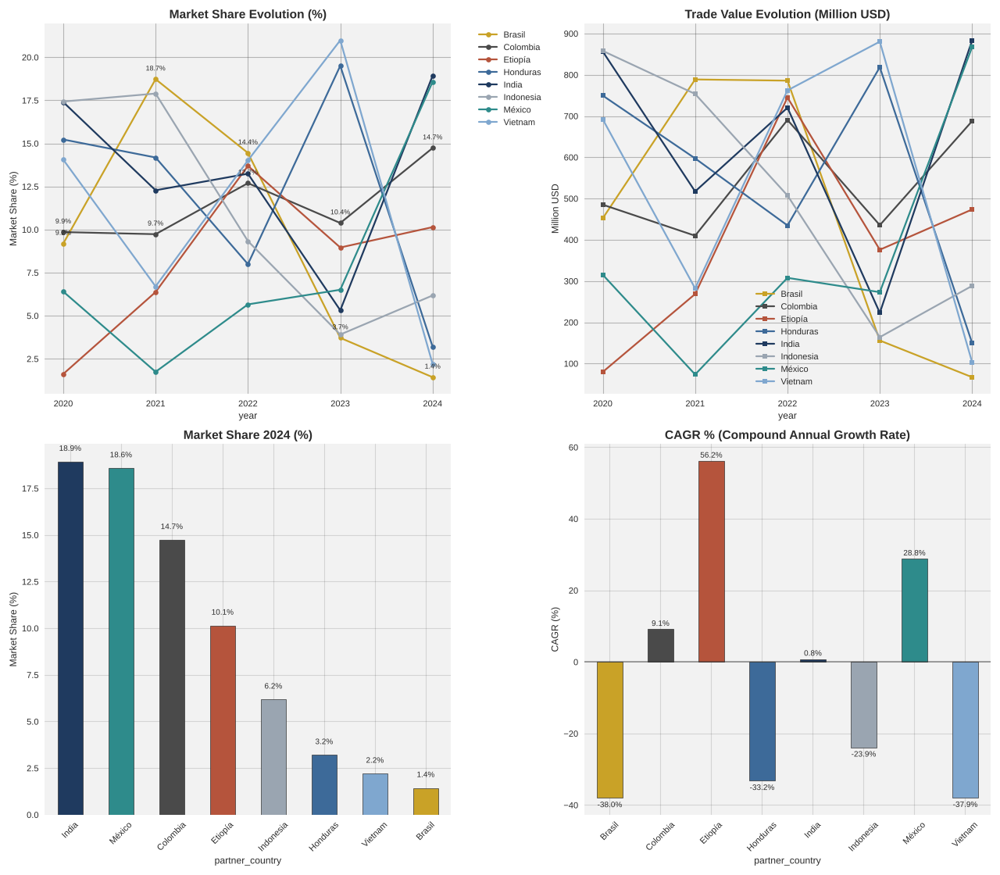
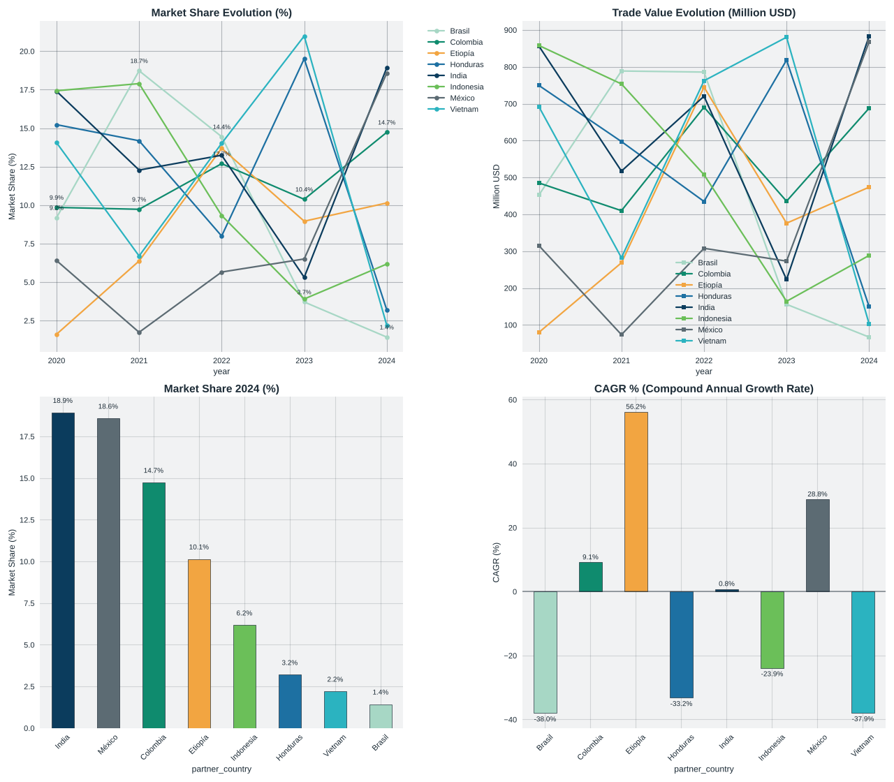
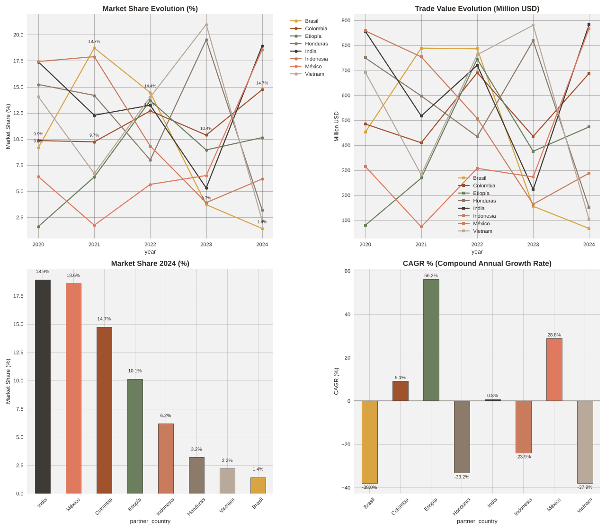
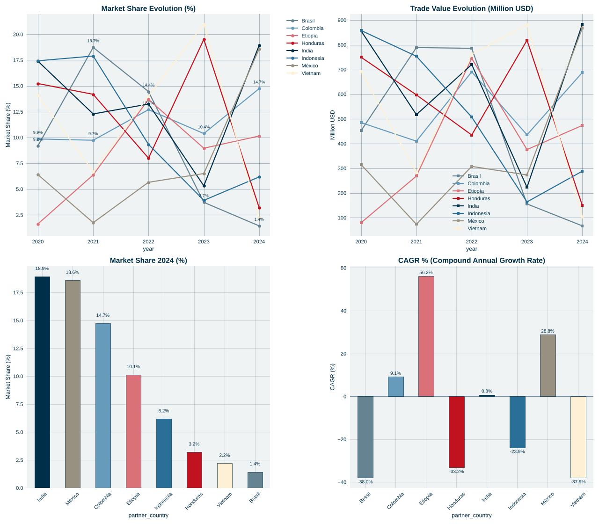
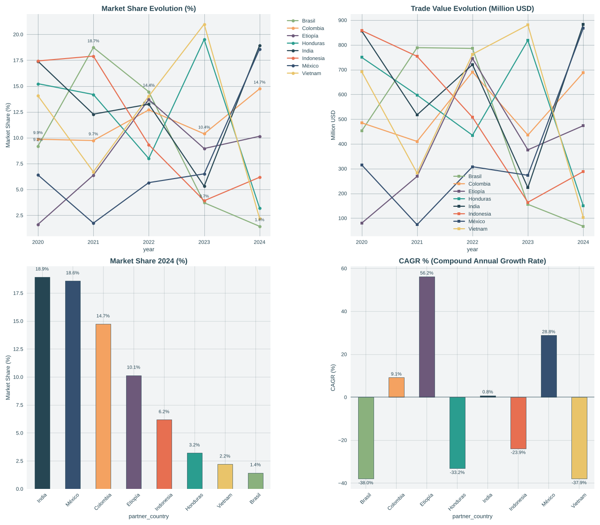
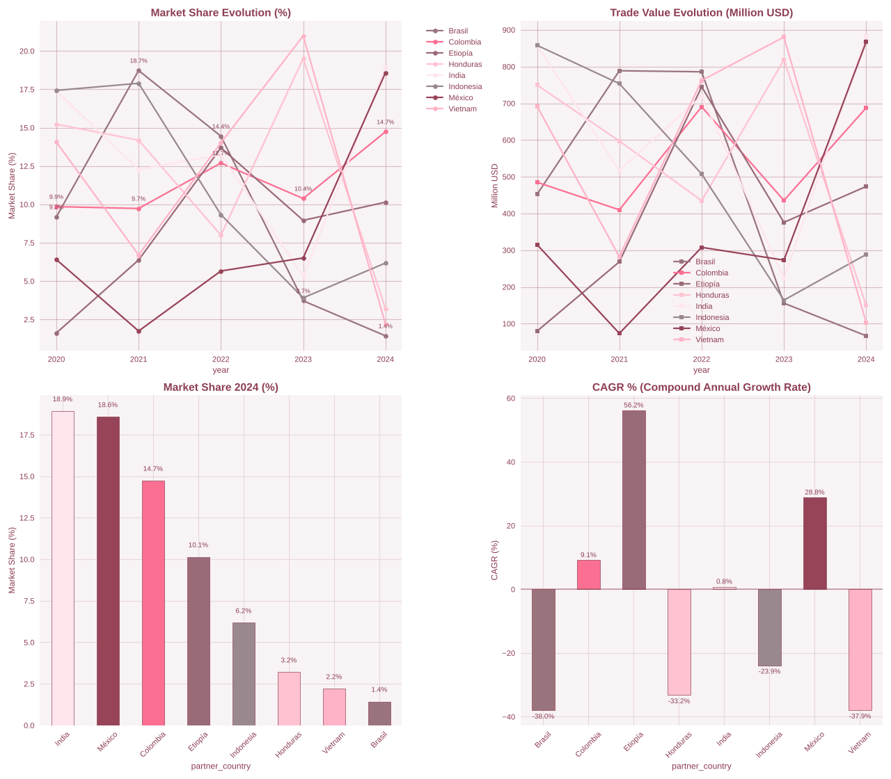

# Evidencias de funcionamiento — apartados 4.2 y 4.5

> ⚠️ **Datos de prueba ficticios.** Los archivos de `archivos-prueba/` imitan la estructura de las descargas de TradeMap, pero sus cifras son **inventadas** y solo sirven para probar el código. No representan datos comerciales reales. Las evidencias con datos reales deben generarse en Google Colab con un archivo descargado de [TradeMap](https://www.trademap.org/).

## 4.2. Archivos con diferentes denominaciones de cabeceras

| Archivo de prueba | Cabecera de países | Cabeceras de valor | Particularidad | Resultado |
|---|---|---|---|---|
| `1_espanol.xlsx` | Exportadores | Valor importado en 2020…2024 | Incluye columnas de cantidad y unidad, que deben ignorarse | ✅ Detección automática |
| `2_ingles_con_titulo.xlsx` | Exporters | Imported value in 2020…2024 | Filas de título antes de las cabeceras; fila *World* | ✅ Detección automática |
| `3_html_disfrazado.xls` | Importadores | Valor exportado en 2019…2023 | `.xls` que en realidad es HTML (UTF-8) | ✅ Detección automática |
| `4_solo_anios.xlsx` | País | 2021, 2022, 2023, 2024 | Cabeceras con solo el año | ✅ Detección automática |
| `6_html_latin1.xls` | Exportadores | Valor importado en 2023, 2024 | `.xls` HTML con codificación Latin-1 (tildes) | ✅ Detección automática |
| `5_ambiguo.xlsx` | Nombre / Grupo | Valor importado **y** exportado por año | Dos grupos de valores y sin columna de países clara | ✅ Pide asignación manual; valida entradas erróneas |
| `malo.xlsx` (no incluido) | — | — | Archivo de texto con extensión `.xlsx` | ✅ Mensaje de error claro |

**Compatibilidad con los módulos posteriores:** en todos los casos válidos, `df` conservó las columnas `year`, `partner_country` y `trade_value_usd`. Los apartados 4.3, 4.4, 4.5, 4.6 y 4.7 se ejecutaron **sin modificaciones** (líneas `4.3 ✓ 4.4 ✓ 4.5 ✓ 4.6 ✓ 4.7 ✓` del registro).

Registro completo de la consola: [`log-4.2-carga-archivos.txt`](log-4.2-carga-archivos.txt)

## 4.5. Paletas de colores

### Paletas predeterminadas
| Ejecutivo Clásico | Comercio Global | Corporativo Contemporáneo |
|---|---|---|
|  |  |  |

### Paletas personalizadas (CSS)
| CSS exportado de Coolors (5 colores, formato `#RRGGBBAA`, secciones repetidas) | Bloque `:root` con 9 colores | Paleta de colores claros |
|---|---|---|
|  |  |  |

### Validación ante entradas CSS no válidas
| Entrada | Mensaje obtenido |
|---|---|
| `:root { --a: rojo; --b: rgb(1,2,3); }` | ❌ El código no contiene colores HEX válidos… |
| `:root { --a: #12345; --b: #GGHHII; --c: #1D70A2; }` | ⚠️ Se ignoraron códigos HEX no válidos: #12345, #GGHHII · ❌ Solo se encontró 1 color válido; se necesitan al menos 2. |
| Campo vacío | ❌ No se pegó ningún código CSS. |
| `import os; os.system('echo HACKED') #zzz` | ⚠️ Se ignoraron códigos HEX no válidos: #zzz · ❌ El código no contiene colores HEX válidos… (el texto **no se ejecuta**) |

En los casos con ❌ no se generan gráficos. Además se verificó que `pivot_share` y `pivot_value` no cambian después de generar los gráficos, y que el módulo funciona sin `growth_data` (un solo año de datos): ver `graficos/sin_cagr.png`.

Registro completo de la consola: [`log-4.5-paletas-y-validacion.txt`](log-4.5-paletas-y-validacion.txt)

### Interfaz
Se simuló la interfaz para comprobar su comportamiento: el campo CSS permanece oculto con las paletas predeterminadas, aparece al elegir *Personalizada* y se vuelve a ocultar al regresar a una predeterminada; el botón **Generar gráficos** limpia la salida anterior y vuelve a dibujar con la paleta elegida.

## Pendiente: capturas en Google Colab con datos reales
Para completar la evidencia con datos reales, ejecutar en Colab las celdas 4.1 → 4.5 con un archivo de TradeMap y capturar:
1. La salida de 4.2 (detección de columnas).
2. Los gráficos de 4.5 con una paleta predeterminada.
3. Los gráficos de 4.5 con una paleta pegada desde Coolors.
4. El mensaje de error de 4.5 al pegar un CSS no válido (p. ej. `--a: #GGHHII;`).
